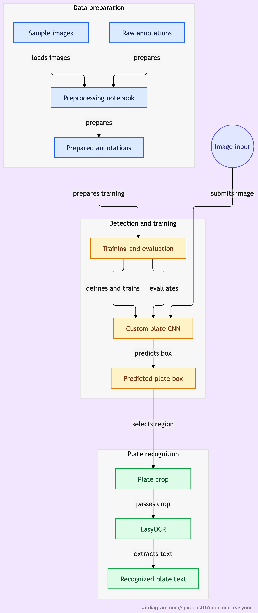

# Automatic License Plate Recognition (ALPR) using Custom CNN & EasyOCR

A complete pipeline to detect and recognize vehicle license plates, designed as the core vision component for an automated toll collection system. This project features a custom 5-layer CNN for plate localization and leverages EasyOCR for character recognition.

---

### ► Key Features

-   **End-to-End System**: Implements the full workflow from image input to recognized plate text.
-   **Custom Detector**: A bespoke 5-layer CNN architecture for bounding box regression, trained from scratch in PyTorch.
-   **Data-Driven**: Trained and validated on a cleaned dataset of ~8,000 images aggregated from multiple public sources.
-   **Reproducible**: Notebooks for data preprocessing and model training are included.

---

## 🚀 Quick Look

| **Component** | **Technology / Method** |
| ------------------------ | -------------------------------------------------------- |
| **Plate Detection** | Custom 5-Layer CNN (PyTorch)                             |
| **Character Recognition**| EasyOCR                                                  |
| **Dataset Size** | ~9,600 images (raw), ~8,000 (cleaned)                    |
| **Input Resolution** | 416x416 (after aspect-ratio preserving resize)           |
| **Detection Loss** | SmoothL1Loss                                             |
| **Training Techniques** | Test-Time Augmentation (TTA), Dropout, Batch Normalization |

---

# Architecture Diagram



---

## 📂 Repository Structure
```
ALPR-CNN-EasyOCR/
│
├── README.md
│
├── 1_Data_Exploration_and_Preprocessing.ipynb
├── 2_Training_and_Evaluation.ipynb
│
├── data/
│   ├── sample_images/
│   └── annotations/
│       ├── final_annotations.csv
│       └── final_annotations_preprocessed.csv
│
└── docs/
    ├── project_presentation.pdf
    └── mid_term_evaluation.pdf
```
---

## 🛠️ How It Works

1.  **Preprocessing**: Input images are resized to `416x416` while preserving the original aspect ratio by adding padding. Bounding box coordinates are normalized.
2.  **Plate Detection**: The custom CNN processes the image and predicts the four coordinates (`xmin`, `ymin`, `xmax`, `ymax`) of the license plate's bounding box.
3.  **Cropping**: The predicted bounding box is used to crop the plate from the original, high-resolution image.
4.  **Character Recognition**: The cropped plate image is passed to **EasyOCR**, which extracts the final license plate text.

---

## 📈 Training & Results

The model was trained using the **Adam optimizer** and a **ReduceLROnPlateau** learning rate scheduler. The notebooks provided in this repository detail the entire process:

-   **`Data_Exploration_and_Preprocessing.ipynb`**: Covers how the raw dataset was loaded, cleaned, visualized, and prepared for training. This includes the logic for normalization and train/validation/test splits.
-   **`Model_Training_and_Evaluation.ipynb`**: Contains the complete model definition, training loop, evaluation logic, and visualization of the loss curves.

For detailed metrics and performance analysis, please see the presentation and report in the `/docs` directory.

---

## 💡 Future Improvements

-   **Enhance OCR Accuracy**: Fine-tune a dedicated OCR model on license plate character sets instead of using a general-purpose one.
-   **Upgrade the Backbone**: Replace the custom CNN with a more powerful, pre-trained backbone (e.g., MobileNetV2, EfficientNet) for potentially higher detection accuracy.
-   **Real-time Video**: Extend the pipeline to handle video streams by incorporating object tracking algorithms to maintain vehicle identity across frames.


